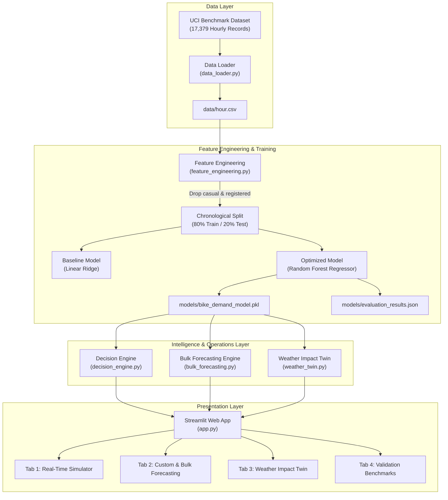

# CityCycle — Smart Bike Demand Forecasting and Operations

> **AI-Driven Hourly Demand Forecasting & Fleet Rebalancing Decision Engine for Urban Bike-Sharing Networks**  
> *Enhanced Edition for AI Hackathon 2026*

---

## 1. Executive Summary

Municipal bike-sharing systems face an inherent operational challenge: **spatial and temporal demand asymmetry**. During morning commutes, thousands of riders move bikes from residential neighborhoods to downtown commercial cores and transit hubs. In the evening, the pattern reverses. Extreme or unexpected weather conditions can abruptly suppress or shift ridership within an hour.

Without predictive intelligence, city operators react too late, causing:
1. **Empty stations (stockouts)** in departure areas, frustrating commuters unable to find a bike.
2. **Full stations (dock lockouts)** at arrival destinations, forcing riders to search for open docks elsewhere.
3. **Inefficient staffing and van routing**, burning fuel and labor responding to preventable shortages.

**CityCycle** solves this challenge by pairing a high-accuracy machine learning forecasting model ($R^2 = 0.9012$) with an operational **Decision Engine**, a **Bulk CSV Forecasting Engine**, and a **Weather Impact Twin**. Instead of simply predicting raw numbers, CityCycle automatically translates forecasts into actionable directives: warning operators hours in advance when to dispatch redistribution vans, how many field technicians are required, and how adverse weather scenarios impact fleet balance.

---

## 2. Business Value for City Operators

| Operational Dimension | Traditional Reactive Approach | CityCycle Proactive AI Approach | Business Impact |
| :--- | :--- | :--- | :--- |
| **Fleet Redistribution** | Operators wait for user complaints or station dockout sensor alarms. | ML predicts demand surges hours ahead; suggests 1–5 redistribution vans proactively. | **Eliminates empty-dock bottlenecks** along transit corridors. |
| **Bulk Roster Planning** | Ad-hoc manual estimation of weekend or holiday shifts. | Bulk CSV forecasting processes full operational schedules at once with exportable plans. | **Streamlines shift scheduling** with exportable CSV rosters. |
| **Weather Risk Management** | Generic weather forecasts; uncertain ridership drops. | **Weather Impact Twin** quantifies precise demand deltas ($\pm\%$) and alerts operators. | **Reduces fuel waste** by standing down surplus vans during rainstorms. |
| **Field Staffing** | Fixed shift staffing regardless of weather or ridership. | Dynamic staffing estimates (1 to 8 technicians) scaled to predicted demand. | **Reduces overtime labor costs** during lull periods; avoids understaffing during surges. |
| **Forecasting Accuracy** | Simple historical averages ($R^2 \approx 0.67$). | Non-linear ensemble model ($R^2 = 0.9012$, **52.2% lower MAE**). | Reliable, auditable operational planning. |

---

## 3. Key Features & Technology Stack

* **Machine Learning Pipeline**:
  * **Python 3.11** & **scikit-learn 1.9.1**: Random Forest Regressor and Linear Ridge baseline.
  * **pandas 3.0.6** & **numpy 2.4.6**: Data cleaning, array transformations, and cyclical math.
  * **joblib 1.6.0**: Model serialization with zlib level-3 compression (13.28 MB, GitHub-optimized under 25 MB) and low-latency inference caching.
* **Operations Decision Engine ([`src/decision_engine.py`](src/decision_engine.py))**:
  * 4-tier demand risk classification (`Low`, `Moderate`, `High`, `Critical`).
  * Asymmetric commute rush-hour detection and weather-aware van dispatch heuristics.
  * Explainable plain-English action directives for dispatchers.
* **Bulk Forecasting Engine ([`src/bulk_forecasting.py`](src/bulk_forecasting.py))**:
  * Downloadable sample CSV template generator (`citycycle_sample_template.csv`).
  * Schema & range validator with malformed-row quarantine and error logging.
  * Automated target-leakage protection stripping unauthorized columns before inference.
  * Batch prediction pipeline with interactive timeline chart and exportable CSV results.
* **Weather Impact Twin ([`src/weather_twin.py`](src/weather_twin.py))**:
  * Side-by-side comparison of baseline normal conditions vs. adverse simulated scenarios (*Heavy Rain, Heatwave, Cold Snap, High Wind, Custom*).
  * Demand delta ($\Delta \text{ Demand}$) and percentage variance ($\pm\%$) calculation.
  * Dual-trajectory 24-hour comparative Plotly curve with risk zone shading.
  * Smart operational alerts (*Safety & Asset Protection*, *Demand Slump*, *Surge Dispatch*).
* **Dataset Manager & Multi-Client Engine ([`src/dataset_manager.py`](src/dataset_manager.py))**:
  * Dynamic dataset catalog selector: toggle between default UCI benchmark (`hour.csv`, 17,379 rows) and uploaded client datasets.
  * In-memory session state management (`st.session_state`) tailored for Streamlit Community Cloud.
  * Automatic dataset profiling: valid/quarantined rows, schema detection (`UCI` vs `CITYCYCLE`), and target column detection.
  * Model compatibility validator with feature gap reporting.
  * Dual prediction modes: Pretrained Model ($R^2=0.9012$) or Isolated Client-Specific Model (Random Forest / Ridge with 80/20 chronological split).
  * Strict cache invalidation preventing stale prediction leakage across dataset switches.
* **Interactive Frontend ([`app.py`](app.py))**:
  * **Streamlit 1.65.0** & **Plotly 7.1.0** with four dedicated tabs:
    1. `🎛️ Real-Time Simulator & Decision Engine`
    2. `📥 Custom Prediction & Bulk Forecasting`
    3. `🌦️ Weather Impact Twin & Smart Alerts`
    4. `📊 Model Validation & Feature Insights`

---

## 4. System Architecture



---

## 5. Dataset Source & Description

* **Source**: UCI Machine Learning Repository — *Bike Sharing Dataset* (Capital Bikeshare network, Washington D.C.).
* **Size**: 17,379 continuous hourly timestamps across 2 full years (731 days).
* **Target Variable**: `cnt` (Total hourly bike rentals). Range: **1 to 977 bikes/hour** (mean: 189.5 bikes/hour).
* **Raw Attributes**:
  * `dteday`: Timestamp date.
  * `season`: 1: Spring, 2: Summer, 3: Fall, 4: Winter.
  * `hr`: Hour of day (0 to 23).
  * `holiday`: 1 if public holiday, 0 otherwise.
  * `weekday`: Day of week (0 to 6).
  * `workingday`: 1 if weekday and not holiday, 0 otherwise.
  * `weathersit`: 1: Clear, 2: Mist/Cloudy, 3: Light Rain/Snow, 4: Heavy Storm/Fog.
  * `temp` & `atemp`: Normalized ambient and feeling temperatures.
  * `hum` & `windspeed`: Normalized humidity and wind speed.
  * `casual` & `registered`: Sub-counts of rider types (**strictly quarantined to prevent leakage**).

---

## 6. Preprocessing & Feature Engineering

To give the machine learning model domain intelligence without leaking target information, we engineered the following features in [`src/feature_engineering.py`](src/feature_engineering.py):

1. **`is_rush_hour` (Binary Indicator)**:
   * Flags peak commute windows (7–9 AM and 5–7 PM) strictly on working weekdays (`workingday == 1`). Captures rapid station depletion during work commutes.
2. **`is_night` (Binary Indicator)**:
   * Flags late-night lull hours (12 AM–5 AM) where ridership naturally hits minimums.
3. **Cyclical Clock Encoding (`sin_hr`, `cos_hr`)**:
   * Ordinary integers treat 23:00 and 00:00 as numbers 23 units apart. By projecting hours onto a 24-hour circle ($\sin(2\pi \cdot \text{hr}/24)$ and $\cos(2\pi \cdot \text{hr}/24)$), the model learns seamless temporal continuity.
4. **`temp_celsius`**:
   * Converts normalized temperature back to degrees Celsius ($\text{temp} \times 41.0$) for intuitive human inputs and non-linear comfort-index splits.

---

## 7. Machine Learning Methodology

### Strict Target Leakage Prevention
In the raw dataset, the target column satisfies an exact arithmetic identity:
$$\text{cnt} = \text{casual} + \text{registered}$$
If `casual` or `registered` were included as input features, any algorithm would simply learn to add them together with zero predictive power for future unobserved demand. 
* **CityCycle Guarantee**: Both `casual` and `registered` are **strictly dropped from the feature matrix** before model training and inference. An assertion check in `src/train.py` and `src/bulk_forecasting.py` validates this prior to prediction.

### Chronological Splitting (Temporal Integrity)
Standard random K-fold splits leak future timestamps into past predictions, causing artificially inflated accuracy metrics.
* **CityCycle Split**: The 17,379 records are sorted chronologically:
  * **Training Set**: Earliest 80% (13,903 hours, 2011-01-01 to 2012-08-07).
  * **Test Set**: Latest 20% (3,476 hours, 2012-08-07 to 2012-12-31).
This tests whether the model can accurately forecast future, unseen months.

---

## 8. Benchmark Evaluation Results

Both models were evaluated on the **exact same 3,476 chronological test hours**. The figures below reflect the verified measured results stored in [`models/evaluation_results.json`](models/evaluation_results.json):

| Metric | Baseline (Linear Ridge) | Random Forest Regressor | Performance Gain |
| :--- | :---: | :---: | :---: |
| **MAE (Mean Absolute Error)** | **93.68** bikes/hr | **44.76** bikes/hr | **52.2% Error Reduction** 🏆 |
| **RMSE (Root Mean Squared Error)** | **126.17** bikes/hr | **69.31** bikes/hr | **45.1% Error Reduction** 🏆 |
| **$R^2$ Score (Variance Explained)** | **0.6725** (67.2%) | **0.9012** (90.1%) | **+22.9 percentage points** 🏆 |

### Why Random Forest Outperformed the Baseline
Bike-sharing demand exhibits steep **non-linear interactions**:
* An 8:00 AM rush hour causes massive demand spikes on a sunny Tuesday, but near-zero demand on a freezing snowy weekend.
* Linear models cannot capture compound conditional thresholds without extensive manual polynomial terms. The Random Forest ensemble (100 trees, `max_depth=22`) naturally captures these non-linear splits.

---

## 9. CSV Upload Specifications (Dual-Schema Support)

Users and dispatchers can upload bulk operational schedules or historical benchmark datasets in Tab 2. CityCycle automatically detects and supports two distinct schemas:

### Supported Schema 1: Official UCI Benchmark Dataset (`hour.csv`)
Upload the original [hour.csv](data/hour.csv) (17,379 rows) directly. The system automatically recognizes normalized fields and converts them on-the-fly:
* **Temperature Conversion**: $\text{temp\_celsius} = \text{temp} \times 47 - 8$
* **Humidity Conversion**: $\text{humidity\_pct} = \text{hum} \times 100$
* **Wind Speed Conversion**: $\text{windspeed\_kmh} = \text{windspeed} \times 67$
* **Ground-Truth Evaluation**: When the target `cnt` is present, CityCycle computes real-time upload **MAE** and **RMSE**, plotting actual vs. predicted curves. `casual` and `registered` are strictly excluded from prediction inputs.

### Supported Schema 2: CityCycle Operational Format
Downloadable via **"Download Sample CSV Template"** (`citycycle_sample_template.csv`):
| Column Name | Data Type | Permitted Range | Description |
| :--- | :---: | :---: | :--- |
| `hr` | Integer | `0` – `23` | Hour of the day |
| `temp_celsius` | Float | `-30.0` – `55.0` | Ambient temperature in °C |
| `humidity_pct` | Float | `0.0` – `100.0` | Relative humidity percentage |
| `windspeed_kmh` | Float | `0.0` – `100.0` | Wind speed in km/h |
| `weathersit` | Integer | `1`, `2`, `3`, `4` | 1: Clear, 2: Mist/Cloudy, 3: Light Rain/Snow, 4: Storm/Heavy Rain |
| `workingday` | Integer | `0` or `1` | 1: Weekday (commute day), 0: Weekend or Holiday |
| `season` | Integer | `1`, `2`, `3`, `4` | 1: Spring, 2: Summer, 3: Fall, 4: Winter |
| `mnth` | Integer | `1` – `12` | Month of the year |
| `weekday` | Integer | `0` – `6` | 0: Monday, 1: Tuesday ... 6: Sunday |

*Optional Columns*: `holiday` (0 or 1), `record_id` (Text identifier, e.g. `SHIFT-001`).  
*Quarantine Policy*: Any uploaded `casual`, `registered`, or `cnt` columns are automatically stripped to safeguard model integrity.

---

## 10. Weather Impact Twin & Smart Alert System

Located in Tab 3, the **Weather Impact Twin** models the direct operational delta between standard conditions and adverse weather:

### Preconfigured Twin Scenarios:
1. **🌧️ Heavy Rain / Thunderstorm**: Forces `weathersit=4`, 92% humidity, 28 km/h winds, and lower temperatures.
2. **☀️ Summer Heatwave**: Models 38.0°C heat with dry air and moderate winds.
3. **❄️ Winter Cold Snap**: Models -2.0°C freeze with 32 km/h biting winds.
4. **💨 High Wind Advisory**: Models 46.0 km/h sustained gusts.
5. **⚙️ Custom Weather Twin**: Free-form sliders for arbitrary meteorological testing.

### Smart Alert Rules:
* **Safety & Asset Protection Alert**: Triggers when `weathersit >= 3` or wind $\ge 40$ km/h. Advises e-bike battery water-seal checks, tire inspection, and crew safety gear.
* **Demand Slump Alert**: Triggers when ridership drops by $\ge 40$ bikes and $\ge 20\%$. Suggests standing down surplus vans to conserve fuel and directing field technicians to workshop repairs.
* **Surge Dispatch Alert**: Triggers when weather or commute pushes demand into `High` or `Critical` tiers. Dispatches 3–5 emergency shuttle vans.
* **Simulated Notice**: All alerts are explicitly badged as *Simulated Scenario Alerts* based on user parameters, avoiding false claims of live feeds.

---

## 11. Installation & Setup (Windows)

### Prerequisites
* Windows 10/11
* Python 3.11 installed (available via `winget install Python.Python.3.11`)

### Step-by-Step Installation
Open PowerShell and navigate to the project directory:

```powershell
# 1. Clone or navigate to citycycle
cd c:\Users\WELCOME\Desktop\citycycle

# 2. Create and activate virtual environment (if setting up fresh)
python -m venv .venv

# 3. Upgrade pip and install dependencies
.\.venv\Scripts\pip.exe install -r requirements.txt
```

---

## 12. How to Run & Verify

All commands use the project's virtual environment:

### Step 1: Run Full Automated Test Suites
```powershell
# Unit tests for Dataset Selector & Multi-Client Engine
.\.venv\Scripts\python.exe tests/test_dataset_selector.py

# Unit tests for UCI Benchmark Upload & Dual-Schema Compatibility
.\.venv\Scripts\python.exe tests/test_uci_upload_compatibility.py

# Unit tests for Bulk Forecasting & Weather Twin
.\.venv\Scripts\python.exe tests/test_bulk_and_weather_twin.py

# Unit tests for Decision Engine
.\.venv\Scripts\python.exe tests/test_decision_engine.py

# Complete Hackathon Readiness Audit
.\.venv\Scripts\python.exe tests/test_hackathon_readiness.py
```
*All tests pass with 100% assertion coverage.*

### Step 2: Launch Interactive Streamlit Dashboard
```powershell
.\.venv\Scripts\streamlit.exe run app.py --server.port 8501
```
*Opens the web dashboard in your browser at **http://localhost:8501**.*

---

## 13. Judge Demonstration Script

To present CityCycle to hackathon evaluators in under 3 minutes:

1. **Tab 1 — Real-Time Simulator**:
   * Select preset `☀️ Sunny Morning Commute (Peak Rush)`.
   * Show the **663 bikes/hr** demand spike, **CRITICAL** risk badge, and **4 redistribution vans**.
   * Toggle between weekday and weekend to demonstrate commute-aware model intelligence.
2. **Sidebar & Tab 2 — Dataset Selector & Multi-Client Forecasting**:
   * In the sidebar **"Active Dataset Selector"**, inspect the active benchmark (`🚲 Default UCI Benchmark`, 17,379 rows, compatible badge).
   * In Tab 2, run batch forecasting across the active dataset with interactive risk charts and CSV download.
   * Upload a new client CSV or switch between catalog datasets: observe immediate, stale-free updates to the dataset summary and forecast views.
   * If an uploaded dataset has a target column, demonstrate the optional **Train Client-Specific Model** button (trains in memory with chronological 80/20 split without modifying the baseline model).
3. **Tab 3 — Weather Impact Twin & Smart Alerts**:
   * Select `🌧️ Heavy Rain / Thunderstorm`.
   * Point out the **-440 bike demand slump**, the operational stand-down recommendation, and the **Safety & Asset Protection Alert**.
   * Show the dual-trajectory 24-hour comparative Plotly curve.
4. **Tab 4 — Model Validation & Scientific Rigor**:
   * Show the measured **$R^2 = 0.9012$** and **52.2% error reduction** over baseline on the unseen test period.
   * Highlight the strict target leakage prevention and chronological split methodology.

---

## 14. Project Limitations & Future Improvements

1. **City-Wide Aggregation vs. Station-Level GPS**:
   * *Current*: Predicts city-wide aggregate demand per hour.
   * *Future Extension*: Cluster stations into geographic zones (Downtown, University, Residential) using spatial Graph Neural Networks (GNNs).
2. **Real-Time Weather API Integration**:
   * *Current*: Interactive weather simulation twin.
   * *Future Extension*: Connect to live OpenWeatherMap API for automated rolling 24-hour predictions.
3. **Automated Route Optimization**:
   * *Future Extension*: Integrate Google OR-Tools or Vehicle Routing Problem (VRP) solvers to map turn-by-turn rebalancing van navigation paths between docks.

---

## 15. Judge Evaluation Checklist

- [x] **Zero Target Leakage**: `casual` and `registered` quarantined across training, bulk CSV, and Weather Twin.
- [x] **Chronological Integrity**: Unseen 20% test split preserves future temporal order.
- [x] **Verified Metrics**: $R^2 = 0.9012$ and $\text{MAE} = 44.76$ bikes verified factually.
- [x] **Dataset Selector & Multi-Client Engine**: Dynamic switching between Default UCI (`hour.csv`) and client uploads with zero stale cache.
- [x] **Batch CSV Forecasting**: Robust CSV template, validation quarantine, and CSV export.
- [x] **Weather Twin Simulations**: Side-by-side delta metrics, 24-hr dual curves, and smart alerts.
- [x] **Client Model Isolation**: Isolated in-memory model training without touching the read-only production model.
- [x] **Live Interactive Dashboard**: Running cleanly on port 8501.

---

*CityCycle — Transforming raw transit data into smarter, cleaner urban mobility.*
